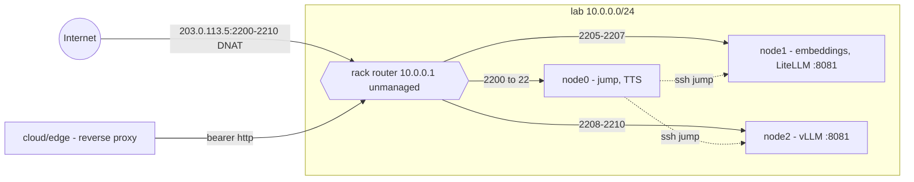

# Namespace card and topology: `<namespace>/README.md`

A namespace is one network, site, rack or provider where hosts make sense together.
Every namespace README starts with a flat YAML frontmatter block and carries a
`## Topology` section and the generated host list.

```yaml
---
namespace: lab
description: the lab rack, the edge gateway and the GPU boxes behind it
cidr: [10.0.0.0/24]
gateway: 10.0.0.1
wan: 203.0.113.5
dns_zones: [example.org]
---
```

| Key | Required | Value |
|---|---|---|
| `namespace` | yes | equals the directory name |
| `description` | no | one line for the root index |
| `cidr` | yes | segments the namespace owns, `[]` for a loose set of VPS |
| `gateway` | yes | default gateway of the primary segment, `null` if none |
| `wan` | no | shared public address of the segment (NAT); omit when there is none |
| `dns_zones` | no | public zones managed from this namespace; omit when there are none |

Hosts that own a public IP carry it in their own `ip`; `wan` describes the NAT in front
of a private segment.

## Topology

`## Topology` holds one Mermaid `graph LR` diagram and, when the namespace has network
gear without its own folder, a `### Network gear` table. One notation everywhere:

| Element | Mermaid | Meaning |
|---|---|---|
| `((Internet))` | circle | the internet or an external network |
| `{{name ip}}` | hexagon | router, gateway, NAT or firewall. Managed ones (own folder) carry the host label, unmanaged ones carry the IP and the word `unmanaged` |
| `[/name/]` | parallelogram | switch or access point; drawn only when traffic between two hosts depends on it or it is managed |
| `[name - role]` | rectangle | a managed host with a folder in the repository |
| `subgraph seg [name cidr]` | box | one L2 segment, labelled with its CIDR |
| `-->` | solid arrow | the default traffic path; label with ports when a DNAT or forward is involved |
| `-.->` | dotted arrow | tunnels, VPN, ssh jumps, proxy egress, cross-namespace links |

**Gateway rule:** traffic that passes through a gateway is drawn through the gateway
node, never as a direct edge from the outside to the host.

Label dotted edges with the pipe form, `-.->|label|`; the `-. label .->` form fails to
parse when the label starts with a digit (an IP or a port).



`### Network gear` lists devices that appear on the diagram but have no folder: device,
IP, role, how it is administered (or `no access`).

Cross-namespace links are drawn on both sides with the dotted arrow and the foreign node
labelled `<namespace>/<host>`.

Draw only what `discover-net.sh` printed or a config on the box shows: re-run it on every
host of the namespace before touching the diagram, and never draw an edge you cannot
point to.

## Generated host list

The namespace README ends with

```
## Hosts

<!-- hosts:start -->
<!-- hosts:end -->
```

and `render_index.py` fills the block. Never edit inside the markers. The root
`README.md` of the harness carries the same markers for the list of every namespace.

## The network map

When `fleet.yaml` has a `map` section, `render_index.py` also writes one self-contained
HTML page that draws the fleet as a graph: the host cards and the gateways and gear of
the namespaces as nodes, the edges of every `## Topology` diagram and the `jump` of every
card. `render_map.py` alone lists the diagram nodes that resolved to nothing in the
repository: a summary rectangle is expected there, a host renamed or moved without its
Topology is a bug in the diagram. The look lives in `templates/network-map.html` of the
skill; the generated file is never edited by hand.
